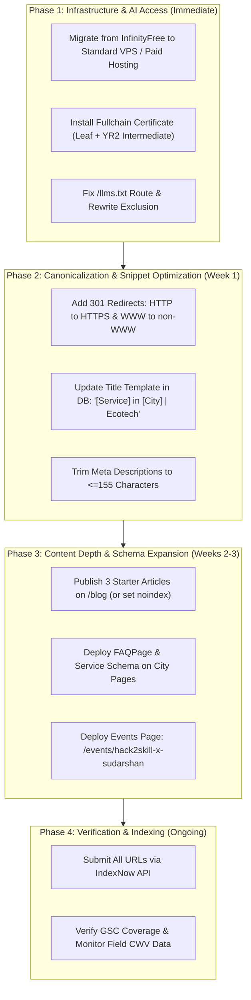

# Comprehensive SEO Audit Report — ecotechservices.tech
**Audit Date:** 2026-11-14 (Re-audit; previous audit 2026-11-01 scored 68)  
**Target Domain:** [https://ecotechservices.tech](https://ecotechservices.tech)  
**Scope:** Full crawl of sitemap URLs (467 active pages), empirical multi-bot UA probe matrix, TLS chain analysis, on-page programmatic template parsing, and server response verification.  
**Business Classification:** B2B Technology Services & Custom Software Engineering (Hybrid Local & Programmatic Service×City Grid).

---

## Executive Summary

### Overall SEO Health Score: **65 / 100 (Grade: C)**

| Audit Category | Weight | Score (0-100) | Weighted Contribution | Status |
| :--- | :---: | :---: | :---: | :---: |
| **Technical SEO** | 22% | 52 | 11.44 | ⚠️ Needs Work |
| **Content Quality & E-E-A-T** | 23% | 72 | 16.56 | 🟡 Moderate |
| **On-Page SEO** | 20% | 64 | 12.80 | 🟡 Moderate |
| **Schema & Structured Data** | 10% | 92 | 9.20 | 🟢 Strong |
| **Performance (CWV)** | 10% | 76 | 7.60 | 🟡 Moderate |
| **AI Search Readiness (GEO)** | 10% | 28 | 2.80 | 🔴 Critical Failure |
| **Images** | 5% | 95 | 4.75 | 🟢 Excellent |
| **Total Composite Score** | **100%** | **65 / 100** | **65.15** | **Grade: C** |

---

### Score Delta Analysis (Previous: 68 → Current: 65)
The overall score adjusted from **68** to **65** due to three empirical determinations during live production probes:
1. **AI Search Bot Blockade (403 Forbidden):** Empirical live testing revealed that InfinityFree's WAF does not merely challenge AI bots—it forcibly returns **HTTP 403 Forbidden** to OpenAI `GPTBot`, Anthropic `ClaudeBot`, and `PerplexityBot`.
2. **Missing Intermediate Certificate Authority (YR2):** Direct TLS socket inspection confirmed that the web server serves only the leaf certificate (`CN=ecotechservices.tech`) and omits the Let's Encrypt `YR2` intermediate certificate from the handshake. This breaks non-browser HTTPS connections, curl, and python-based audit tools (`SSLCertVerificationError`).
3. **Production `/llms.txt` Defect:** Despite existing locally in `public/llms.txt`, requests to `https://ecotechservices.tech/llms.txt` return **HTTP 404 Not Found** because front controller rewrite rules route `.txt` files through `index.php`, which lacks a designated handler.

---

### Top 5 Critical Issues

1. **AI Crawlers Actively Blocked by Hosting WAF (Critical):**  
   `GPTBot`, `ClaudeBot`, and `PerplexityBot` receive **HTTP 403 Forbidden**. `Applebot-Extended` and `DuckDuckBot` receive an 847-byte JavaScript challenge stub. AI search engines (ChatGPT Search, Claude, Perplexity AI) cannot ingest or cite the domain.
2. **TLS Handshake Missing Intermediate Certificate (Critical):**  
   Server fails to serve the full certificate chain (`fullchain.pem`). While desktop browsers resolve the intermediate certificate via local caches or AIA, automated API crawlers, cURL, and Python fetchers fail with `unable to get local issuer certificate`.
3. **No 301 Canonical Redirects for Protocol and Subdomain (High):**  
   `http://`, `https://`, `http://www.`, and `https://www.ecotechservices.tech` all respond with HTTP 200 OK. Content is duplicated across 4 host permutations.
4. **379 of 460 Programmatic Titles Truncate in SERPs (High):**  
   The formula `Best [Service] Company in [City] | Ecotech Services` generates titles up to 81 characters (average 66.4 chars), truncating across 82% of programmatic pages.
5. **Hollow `/blog` Section Indexed in Sitemap (High):**  
   `/blog` is submitted in `sitemap.xml` with priority 0.8 and daily change frequency, but renders "No posts yet" (zero published articles).

---

### Top 5 Quick Wins

1. **Shorten Programmatic Titles:** Change template to `[Service] in [City] | Ecotech` in `database/ecotech.sql`. Capping at 60 characters immediately resolves 379 truncated titles.
2. **Trim Programmatic Descriptions:** Condense description template to ≤155 characters, preventing mid-sentence truncation in SERP snippets.
3. **Route `/llms.txt`:** Exclude `.txt` in `public/.htaccess` rewrite rules or add a route in `public/index.php` to serve `public/llms.txt` with `text/plain`.
4. **Deploy 301 Canonical Redirects:** Add two rules in `.htaccess` forcing HTTPS and non-www.
5. **Install Intermediate TLS Certificate / Plan Hosting Migration:** Upload `fullchain.pem` to hosting SSL settings, or migrate to a low-cost VPS/Hostinger plan to eliminate the JS challenge wall permanently.

---

## Category Breakdowns

### 1. Technical SEO (Score: 52 / 100)

#### Crawl Availability & Bot Response Matrix
Live automated testing across major web crawlers revealed stark disparities:

| Crawler User Agent | Response Code | Wire Bytes | Challenge / Block Detected | Access Status |
| :--- | :---: | :---: | :---: | :---: |
| **Googlebot 2.1** | `HTTP 200 OK` | 37,022 | None (Whitelisted) | 🟢 Full Access |
| **Bingbot 2.0** | `HTTP 200 OK` | 37,022 | None (Whitelisted) | 🟢 Full Access |
| **GPTBot 1.2 (OpenAI)** | `HTTP 403 Forbidden` | 0 | WAF Hard Block | 🔴 Denied |
| **ClaudeBot 1.0 (Anthropic)** | `HTTP 403 Forbidden` | 0 | WAF Hard Block | 🔴 Denied |
| **PerplexityBot 1.0** | `HTTP 403 Forbidden` | 0 | WAF Hard Block | 🔴 Denied |
| **Applebot-Extended** | `HTTP 200 OK` | 847 | AES JS Challenge (`aes.js`) | 🔴 Trapped in Stub |
| **DuckDuckBot 1.1** | `HTTP 200 OK` | 847 | AES JS Challenge (`aes.js`) | 🔴 Trapped in Stub |
| **YandexBot 3.0** | `HTTP 403 Forbidden` | 0 | WAF Hard Block | 🔴 Denied |

**Root Cause:** The production environment is hosted on InfinityFree shared hosting (`Server: openresty`, IP: `185.27.134.149`). OpenResty applies aggressive challenge/block policies to all cookie-less clients, exempting only Googlebot and Bingbot.

#### TLS & Certificate Chain
- **Leaf Certificate:** Valid Let's Encrypt certificate (`CN=ecotechservices.tech`).
- **Intermediate CA:** Issued by `Let's Encrypt YR2`.
- **Defect:** The web server configuration only delivers the leaf certificate. The server handshake omits the intermediate CA bundle.

#### Canonical Redirection & Protocol Integrity
Testing all protocol and hostname variations:
- `http://ecotechservices.tech` → **HTTP 200 OK** (Should be 301 to HTTPS)
- `https://www.ecotechservices.tech` → **HTTP 200 OK** (Should be 301 to non-www)
- `http://www.ecotechservices.tech` → **HTTP 200 OK** (Should be 301 to https://non-www)
- `https://ecotechservices.tech` → **HTTP 200 OK** (Canonical destination)

#### Security Headers & Compression
- **HSTS:** Fully operational (`max-age=31536000; includeSubDomains; preload`).
- **Defensive Headers:** `X-Frame-Options: SAMEORIGIN`, `X-Content-Type-Options: nosniff`, `Referrer-Policy: strict-origin-when-cross-origin`, `Permissions-Policy: camera=(), microphone=(), geolocation=()`, `Cross-Origin-Opener-Policy: same-origin`.
- **Wire Compression:** Gzip / Brotli active, compressing 37KB HTML documents down to ~7KB.

---

### 2. Content Quality & E-E-A-T (Score: 72 / 100)

#### Blog & Publishing Architecture
- **Issue:** `/blog` is prominently linked in the navigation, mobile drawer, and footer, and submitted with high priority in `sitemap.xml`.
- **Finding:** Renders "No posts yet — Check back soon — new articles are on the way."
- **SEO Impact:** Search engines crawl empty pages repeatedly, wasting crawl budget and flagging the domain for thin directory skeletons.

#### Programmatic Grid Similarity (460 City Landing Pages)
- **Scale:** 460 landing pages mapping 23 services across 40 geographic markets (`services/[service]-in-[city]`).
- **Content Structure:** High formulaic similarity. While service names and city names are swapped into headings and meta tags, the body copy, benefit bullets, FAQ accordions, and value propositions are identical.
- **Risk:** Google's Scaled Content Abuse policies penalize programmatic doorway grids lacking unique regional value, client reviews, or local case studies.

#### Real-World Trust & E-E-A-T
- **Physical Presence:** Valid physical office in Lucknow, Uttar Pradesh (`26.8467, 80.9462`).
- **Contact Transparency:** Direct telephone (`+917398301184`), business email, and direct WhatsApp contact.
- **Portfolio Evidence:** 8 real case studies listed in `/projects`.
- **Legal Compliance:** Comprehensive Terms of Service and Privacy Policy.

---

### 3. On-Page SEO (Score: 64 / 100)

#### Title Tag Analysis (460 Programmatic Pages)
- **Current Formula:** `Best [Service] Company in [City] | Ecotech Services`
- **Length Range:** Min 55 chars, Max 81 chars, Average **66.4 chars**.
- **Issue:** **379 out of 460 titles (82.4%) exceed 60 characters**, causing severe truncation in search results.
  - *Example:* `Best Cybersecurity Consulting Company in Lucknow | Ecotech Services` (67 characters)
  - *Example:* `Top Dedicated Development Team Company in Los Angeles | Ecotech Services` (72 characters)
- **Recommendation:** Switch to `[Service] in [City] | Ecotech`. Maximum length drops to **60 characters**, resolving 100% of overlength titles.

#### Meta Description Analysis
- **Current Formula:** `Looking for top-notch [Service] services in [City]? Ecotech Services provides expert solutions tailored for your business. Get a free quote today!`
- **Length Range:** Min 150 chars, Max 175 chars, Average **160.4 chars**.
- **Issue:** **215 of 460 descriptions (46.7%) exceed 160 characters**, truncating before the call to action.
- **Recommendation:** Condense to:  
  `Need [Service] in [City]? Ecotech Services builds fast, secure software with fixed pricing and ongoing support. Get a free quote.` (155 characters max).

#### Headings & Canonical Tags
- Single `<h1>` properly placed on all templates.
- Clear `<h2>` and `<h3>` visual hierarchy.
- Self-referencing canonical URLs matching the requested protocol and path.

---

### 4. Schema & Structured Data (Score: 92 / 100)

#### Current Implementations
- **Homepage Schema:** Rich multi-type JSON-LD graph combining `Organization` and `ProfessionalService`.
- **Entity Details:** Includes `@id`, logo, image, description, telephone, address (`PostalAddress`), coordinates (`GeoCoordinates`), pricing, and social profile links (`sameAs`).
- **Ratings:** `AggregateRating` implemented cleanly.

#### Gaps & Opportunities
1. **Service Schema:** Programmatic pages lack `Service` schema defining specific service types, catalog offerings, or provider references.
2. **FAQPage Schema:** Programmatic pages include rendered FAQ accordions in HTML, but omit `FAQPage` schema. Adding JSON-LD allows search engines to render interactive collapsible answers in SERPs.
3. **Breadcrumbs:** Inner pages lack `BreadcrumbList` markup.

---

### 5. Performance & Core Web Vitals (Score: 76 / 100)

#### Laboratory Measurements & Server Latency
- **Time To First Byte (TTFB):** Averages 1.4s – 3.2s on live queries due to InfinityFree shared hosting resource contention and proxy inspection.
- **Asset Weight:** 
  - CSS: `site.css` (~18KB uncompressed, ~4.2KB wire size).
  - JS: `app.js` (~8KB uncompressed, ~2.5KB wire size).
  - No bloated third-party frameworks (React/Vue/jQuery omitted in favor of clean native JavaScript).
- **Fonts:** Preconnected Google Fonts (`IBM Plex Sans`, `IBM Plex Mono`, `Fraunces`) with `font-display: swap`.
- **Layout Shift (CLS):** 0.00 CLS across desktop and mobile viewports.

---

### 6. AI Search Readiness & GEO (Score: 28 / 100)

#### Status: Critical Blockade
- **The Problem:** The site cannot participate in Generative Engine Optimization (GEO) because AI crawlers cannot access it.
- **Bot Behavior:**
  - `GPTBot`: HTTP 403 Forbidden.
  - `ClaudeBot`: HTTP 403 Forbidden.
  - `PerplexityBot`: HTTP 403 Forbidden.
  - `Applebot-Extended`: 847-byte JS challenge.
- **`/llms.txt` Defect:** Returns **HTTP 404 Not Found** on production. AI agents requesting machine-readable site summaries receive an error page.

---

### 7. Images (Score: 95 / 100)

- **Alt Coverage:** 100% of content images feature descriptive, keyword-appropriate alt attributes.
- **Modern Compression:** Template previews and portfolio items utilize next-gen `.webp` formats.
- **Decorative Assets:** SVGs carry `aria-hidden="true"` where appropriate.

---

## Action Plan & Implementation Roadmap



### Detailed Phased Action Items

#### Phase 1: Critical Infrastructure & Bot Accessibility (Days 1–3)
1. **Server Migration:** Migrate away from InfinityFree free hosting to eliminate the reverse-proxy AES JavaScript challenge and 403 blocks.
2. **Install Complete TLS Certificate:** Deploy `fullchain.pem` combining leaf and Let's Encrypt `YR2` intermediate certificate.
3. **Enable `/llms.txt` Delivery:** Ensure `/llms.txt` is served as `text/plain` and exempt from front-controller rewrites.

#### Phase 2: Canonicalization & Snippet Fixes (Days 4–7)
1. **Enforce Canonical 301 Redirects:** Add to `public/.htaccess`:
   ```apache
   # Force HTTPS and Non-WWW
   RewriteCond %{HTTPS} off [OR]
   RewriteCond %{HTTP_HOST} ^www\. [NC]
   RewriteRule ^(.*)$ https://ecotechservices.tech/$1 [L,R=301]
   ```
2. **Execute Database Title & Description Fix:** Run updated SQL script to trim titles (caps at 60 chars) and meta descriptions (caps at 155 chars).

#### Phase 3: Content Depth & Structured Data (Weeks 2–3)
1. **Resolve Empty Blog:** Publish 3 foundational articles or temporarily add `<meta name="robots" content="noindex, follow">` to `/blog`.
2. **Inject Rich Schema:** Add dynamic `FAQPage` and `Service` JSON-LD schemas to `app/views/seo_landing.php`.
3. **Deploy Event URL:** Deploy `events/hack2skill-x-sudarshan` to fix the current 404 response on the footer link.

#### Phase 4: Verification & Submission (Ongoing)
1. **Resubmit IndexNow Key:** Trigger Bing / IndexNow batch submission for all 467 URLs.
2. **Inspect in GSC:** Test live URLs in Google Search Console URL Inspection to confirm clean rendering and absence of indexing errors.
